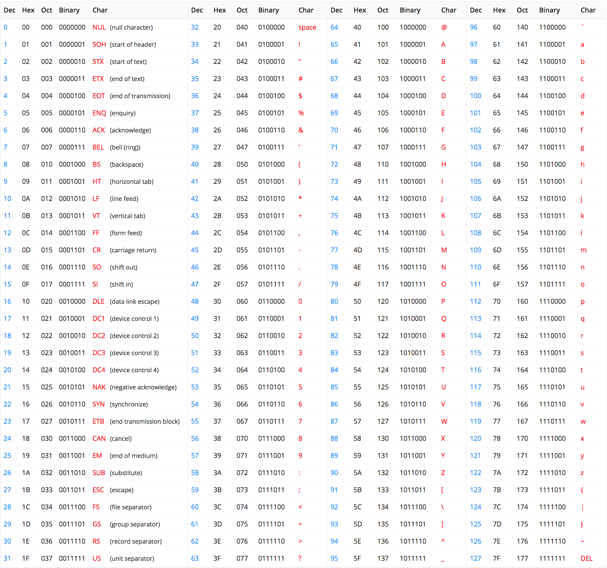
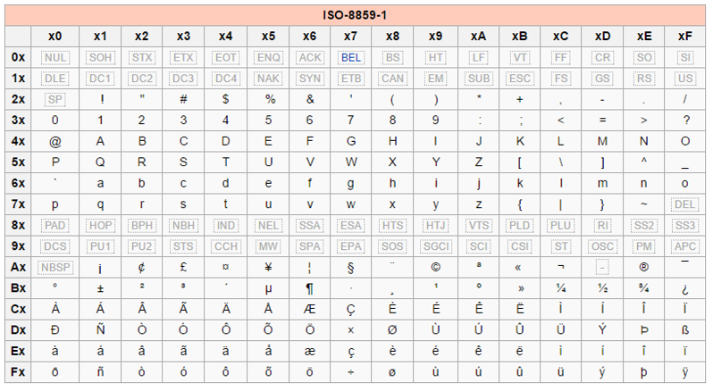

# Représentation d'un texte en machine  

## Généralités  
Chaque information sur un ordinateur finit par être convertit en nombre. Il en va de même pour les caractères qui compose un texte.  
Ainsi, selon le système d'encodage utilisé un caractère possède un code.  

## 1er système d'encodage : ASCII  

- Le code __ASCII__ (American Standard Code for Information Interchange) a été proposé dans les années 60 pour standardiser la représentation des caractères.   
- Chaque caractère possède __un code__ représenté en binaire sur 7 bits. 

Voici la table ASCII. 

  

Dans la table ASCII on compte 128 caractères différents, parmi eux on à :
- 95 caractères imprimables(minuscules, majuscules, caractères spéciaux, nombres)   
- 33 caractères non imprimables. Ces caractères sont surtout utile pour la syntaxe du texte par exemple on à le caractère espace

 
La table ASCII est très pratique pour représenter les __textes écrits en Anglais__. 
En revanche, on remarque que les caractères accentuées ne peuvent pas être représentée. Il n'est donc pas possible d'écrire un texte en français.  

## 2ème système d'encodage ISO-8859-1  

__L'Organisation Internationale de Normalisations(ou ISO en anglais)__ à défini une norme informatique afin de représenter plus de caractères que ne le permet la table ASCII.   
La première partie de cette norme se nomme __ISO-8859-1__ également appelée __Latin 1__.

Voici la table __ISO-8859-1__  

Chaque point de code est représenté sur 8 bits c'est à dire 1 octet.  
Dans la table ISO-8859-1 on a: 

- __Les 128 caractères de la table ASCII__  
- __128 nouveaux caractères__ parmis eux on a les caractères accentuées en minuscules et majuscule, des symboles mathématiques etc...

## Unicode : standard  

L'ensemble de tout les caractères utilisés à travers chaque langages du monde à fait naître un standards informatique appelé __Unicode__.  
Ce standard est développer par le consortium du même nom : __Consortium Unicode__.  

Chaque caractère peut être codé sur 4 octets. C'est à dire qu'on utilise 32 bits et $2^{32} \approx 4 \text{milliards}$. 
Avec une telle représentation on est certain que l'ensemble des caractères utilisable dans le monde peuvent posséder leur unique point de code.  

Le standard Unicode est constitué :
- d'un répertoire de 159 801 caractèrescouvrant plus de 150 écritures,
- etc...

Les différentes tables Unicode sont disponibles sur le site wikipédia juste [ici](https://fr.wikipedia.org/wiki/Table_des_caract%C3%A8res_Unicode_(0000-0FFF))

