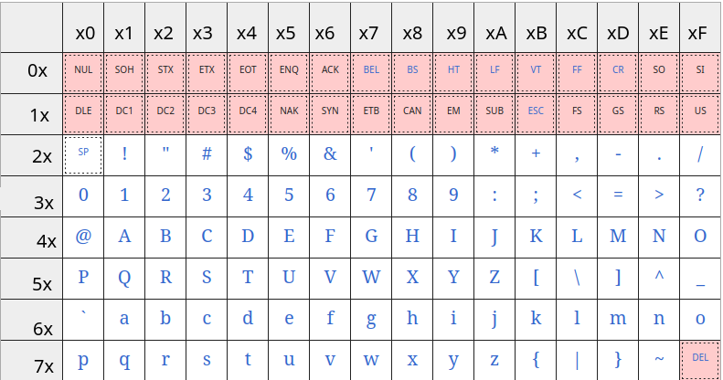
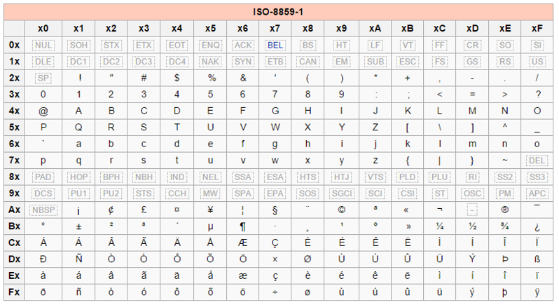

# TP1 représentation d'un texte en machine

## Q1  
Un ordinateur réceptionne un message codé en ASCII. 
Voici le code ASCII de chaque caractère reçu.  

$44\space 72\space 61\space 67\space 6F\space 6E$    

Décodez ce message à l'aide de la table ASCII ?  

## Q2  
Même question mais cette fois ci-le message codé en ASCII est reçu en binaire. 

$0100\space 1111;\space 0110\space 1011$

Décodez ce message à l'aide de la table ASCII de la Q1.  

## Q3  
A l'aide de la table ASCII, donnez le code en hexadécimal du message `Porte`.    

## Q4  
Pourquoi il n'est pas possible de codé le mot `Porté` en ASCII ?

## Q5 
Voici la table ISO-8859-1.   
  
Coder le mot `Là` avec cette table.   

## Q6
Utiliser la table ISO-8859-1 pour décoder ce message $74\space F4\space 74$  

## Q7  
Les tables ASCII et ISO-8859-1 sont relativement petite, cela facilite l'encodage ou le décodage à la main.  
Comme vu dans le cours, Unicode couvre énormément de caractères.  
Il est donc difficile de chercher à l'oeil nu un code.  

Nous allons, faire les étapes nécessaire pour __retrouver le code UTF-8__ du caractère `é` pour s'assurer que ce n'est pas aussi facile qu'avec les autres systèmes d'encodage.  

1. En premier lieu, il faut trouver le point de code de `é` qui est `U+00E9`. 
2. Grâce au point de code, regarder dans le tableau suivant sur combien d'octets est codé ce caractères ?  

|   Plage Unicode    | Nombre d’octets en UTF-8 |            Modèle UTF-8             |
| :----------------: | :----------------------: | :---------------------------------: |
|  U+0000 à U+007F   |            1             |              0xxxxxxx               |
|  U+0080 à U+07FF   |            2             |          110xxxxx 10xxxxxx          |
|  U+0800 à U+FFFF   |            3             |     1110xxxx 10xxxxxx 10xxxxxx      |
| U+10000 à U+10FFFF |            4             | 11110xxx 10xxxxxx 10xxxxxx 10xxxxxx |

3. Donner l'écriture en binaire du point de code hexadécimal `E9`.  
4. En reprenant le tableau de l'étape 2, récupérer le modèle UTF-8 correspondant et remplacer les `x` par l'écriture binaire de l'étape 3. Si certains x ne sont pas complété, remplacer les par des 0.  
5. Les 2 octets de l'étape 4 doivent être lus et convertis séparrément. Convertissez les en hexadécimal. Le résultat obtenu est le code UTF-8 du caractère `é`.  

## Q8    
Le message codé suivant vous parvient :  
$63\space 61\space 66\space C3\space A9$   

1. Vous supposez que ce message est codé en ISO-8859-1. En vous servant des aides plus bas décoder et donner le message obtenu.   
2. Faites la même chose avec le système d'encodage UTF-8.  

Aide : 

| Caractère |    ISO-8859-1     |  UTF-8   |
| :-------: | :---------------: | :------: |
|     é     |        E9         |  C3 A9   |
|     è     |        E8         |  C3 A8   |
|     ©     |        A9         |  C2 A9   |
|     ê     |        EA         |  C3 AA   |
|     à     |        E0         |  C3 A0   |
|     ç     |        E7         |  C3 A7   |
|     ù     |        F9         |  C3 B9   |
|     €     | Non représentable | E2 82 AC |
|     f     |        66         |    66    |
|     c     |        63         |    63    |
|     e     |        65         |    65    |
|     h     |        68         |    68    |
|     g     |        67         |    67    |
|     z     |        7A         |    7A    |
|     a     |        61         |    61    |
|     u     |        75         |    75    |
|     n     |        6E         |    6E    |
|     Ã     |        C3         |  C3 83   |

